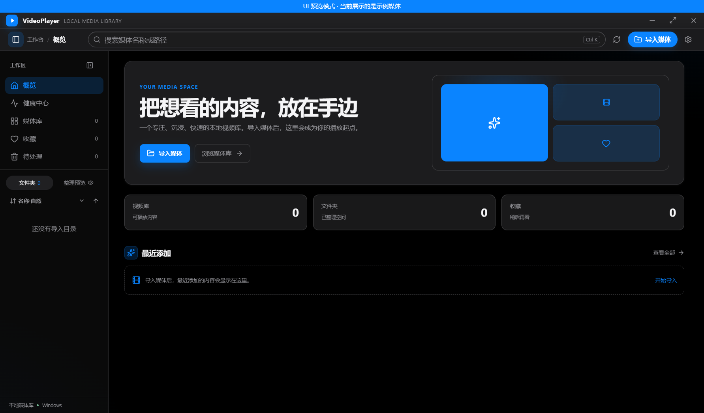

# VideoPlayer

一个面向 Windows 的本地媒体库管理器与播放器。

VideoPlayer 把分散在硬盘、移动硬盘和多个目录里的媒体集中到一个本地库中，提供目录浏览、缩略图、搜索、收藏、分类整理和播放能力。数据保存在本机 SQLite 中，不需要账号，也不会把媒体文件上传到云端。



## 为什么做 VideoPlayer

当本地媒体数量变多之后，资源管理器适合“找文件”，但不适合持续浏览、筛选和管理媒体。VideoPlayer 试图把这些操作放在一个更适合媒体的界面里：

- 导入一次，后续增量刷新
- 通过目录树、搜索、收藏和媒体类型快速缩小范围
- 用缩略图瀑布流或紧凑列表浏览大量内容
- 用 mpv 播放浏览器难以处理的高码率、HEVC、10-bit 和 MKV 文件
- 将已分类的视频按规则整理到目标目录

## 功能

### 媒体库

- 支持视频、音频、小说和漫画目录
- 递归导入文件夹，增量发现新增、修改和删除的文件
- 保留原始目录树，并支持多目录筛选
- 目录支持名称（Windows 自然排序）、导入日期和目录大小排序
- 支持搜索、收藏、媒体类型筛选和待处理列表
- 支持网格视图与紧凑列表视图，视图选择会自动保存
- 侧边栏宽度可拖动调整，并会记住上次宽度

### 播放与阅读

- 视频使用 mpv 播放内核，支持播放、暂停、进度、音量和倍速控制
- mpv 窗口嵌入 VideoPlayer，底部控制栏由 React 绘制
- 记录播放进度，重新打开后可继续观看
- 音频使用独立音乐播放界面
- TXT 小说支持阅读进度、字号和行距调整
- 漫画目录按页浏览
- 提供竖屏刷视频模式，适合快速浏览可由浏览器解码的短视频

### 分类与整理

- 创建、重命名、排序和停用整理分类
- 媒体卡片支持悬浮快捷分类，设置中心可以关闭
- 支持批量分类
- 有待整理文件时，顶部会显示常驻的“整理文件”入口
- 按分类创建目标目录并移动文件
- 整理前显示确认信息，整理中显示进度，完成后刷新库状态
- 支持集中整理目录；跨盘文件会按来源盘符处理，避免不必要的跨盘复制

### 健康与清理

- 健康中心检查失效媒体、缺少缩略图、离线磁盘、空目录和待整理内容
- 媒体可以先标记为待处理，避免误删
- 待处理页面支持多选、恢复、导出文件名列表和永久删除
- 删除操作会同步清理数据库记录、缩略图和相关空目录

### 外观与体验

- 日间和夜间主题
- 支持壁纸、设置中心背景模糊和透明效果使用范围
- 缩略图后台生成，不阻塞主界面浏览
- 支持键盘导航、焦点卡片和常用快捷键
- 适配高分辨率窗口、最大化和全屏状态

## 安装

从 [Releases](https://github.com/suaohub/VideoPlayer/releases) 下载 Windows x64 安装包，运行安装程序即可。安装程序默认创建桌面和开始菜单快捷方式，也允许选择安装目录。

VideoPlayer 使用外部 mpv 和 FFmpeg：

- **mpv**：负责视频和音频播放
- **FFmpeg / ffprobe**：负责缩略图和媒体元数据

程序会按以下顺序查找 mpv：

1. `MPV_BIN` 环境变量
2. `C:\\Program Files\\MPV Player\\mpv.exe`
3. 系统 `PATH` 中的 `mpv`

FFmpeg 可以通过 `FFMPEG_BIN` 和 `FFPROBE_BIN` 指定路径。安装后如果无法播放或生成缩略图，优先检查这两个依赖是否可用。

## 快捷键

| 快捷键 | 作用 |
| --- | --- |
| `Ctrl + K` | 聚焦搜索框 |
| `Delete` | 将当前焦点媒体标记为待处理 |
| `Enter` | 在播放器或阅读器中返回媒体库 |
| `Ctrl + Shift + B` | 播放视频时截取当前画面并设为应用壁纸 |
| `B` | 在刷视频模式中截取当前视频帧 |
| `Space` | 播放或暂停 |
| `←` / `→` | 后退或前进 |

## 数据位置

默认数据保存在：

```text
C:\\Users\\<用户名>\\AppData\\Roaming\\videoplayer\\
```

其中包含 SQLite 数据库、应用设置和缩略图缓存。媒体原文件不会被复制进数据库目录。

## 从源码运行

### 环境要求

- Windows 10 或 Windows 11
- Node.js 18 或更高版本
- mpv
- FFmpeg 与 ffprobe

### 开发启动

```bash
npm install
npm run rebuild:electron
npm run dev
```

开发环境会同时启动 Vite、Electron 主进程和 Electron 渲染窗口。应用使用本地 SQLite 数据库，不需要额外启动数据库服务。

### 构建与打包

```bash
npm run build
npm start
npm run dist
```

安装包会输出到 `release/v版本号/`，不同版本使用不同目录，不会覆盖旧版本的打包产物。

## 项目结构

```text
VideoPlayer/
├── electron/              # Electron 主进程、SQLite、扫描、mpv 和 IPC
├── src/                   # React 界面和媒体库组件
├── assets/                # 应用图标
├── docs/                  # 产品和开发文档
├── release/               # 各版本打包产物
├── package.json
└── vite.config.ts
```

主要模块：

- `electron/scanner.ts`：扫描目录、识别媒体、生成目录树
- `electron/queries.ts`：SQLite 查询、过滤、排序和设置
- `electron/mpv.ts`：mpv 进程、JSON IPC 和窗口嵌入
- `electron/thumbnailQueue.ts`：后台缩略图队列
- `src/App.tsx`：应用状态和页面组织
- `src/components/VideoGrid.tsx`：媒体网格、列表和批量操作
- `src/components/SettingsModal.tsx`：设置中心
- `src/themes.css`：主题、布局和交互状态

## 项目状态

VideoPlayer 目前处于持续打磨阶段。核心的导入、浏览、播放、分类整理和本地数据管理已经可用，界面和大媒体库性能仍在持续优化。

欢迎提交 Issue、功能建议和改进代码。提交问题时，最好附上 Windows 版本、VideoPlayer 版本、复现步骤和相关日志。

## 许可证

本项目使用 ISC License，详见 `package.json`。